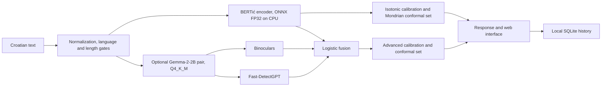

# Architecture

Oriđiđi is a localhost application for document-level analysis of Croatian text. The
archive contains serving code, configuration, web assets, tests and the `models/`
directory with the Basic model and its calibrations. Corpora, training and evaluation
pipelines and Gemma weights are not included; Advanced mode is prepared locally by
`install.ps1` (see [DEMO.md](DEMO.md)).

## Request path

Basic uses the encoder alone, which reads the first 160 tokens of the text. Advanced
fuses the raw encoder score with Binoculars and Fast-DetectGPT by logistic fusion; the
two statistical detectors share one Gemma-2-2B observer/performer pair and read up to
512 tokens. Linguistic features support explanations but do not enter the final
percentage. An unavailable Advanced component must be reported as unavailable or as an
explicit Basic fallback, never as a successful Advanced result.

Both modes return a calibrated estimate, a Mondrian conformal prediction set (alpha =
0.10) and a label: `LIKELY_HUMAN`, `INCONCLUSIVE` (abstention) or `LIKELY_AI`. Abstention always follows from an empty
set; two-element sets do not occur. Neither the estimate nor the token trace
establishes authorship. The service does not provide a per-segment authorship map.

| | Basic | Advanced |
|---|---|---|
| Calibration | isotonic | logistic fusion with its own calibration |
| q0 / q1 | 0.0800 / 0.0833 | 0.0411 / 0.0536 |
| Decision threshold | 0.889 | 0.932 |
| Evaluated on | GPU and CPU | GPU only |

## Runtime and storage

The portable serving configurations are `configs/profiles/basic.yaml` (Basic only) and `configs/profiles/demo.yaml` (Basic and Advanced). It resolves paths
relative to `--candidate-root` or `ORIDJIDJI_CANDIDATE_ROOT`; the default is `models/`.
With no compatible model artefacts, the API can start and refuse analysis.
`install.ps1` and `install.sh` verify the files in `models/` against the SHA-256
digests in `release_manifest.json`; and download missing files from its `base_url` (or the
`-BaseUrl` parameter), because the artefacts are not included in the archive. Gemma weights are not redistributed (Gemma Terms
of Use).

The application records result metadata in local SQLite history. Full submitted text
and token heatmap snippets are retained only when the user selects text storage for
that analysis. The immediate response may still show snippets on the user's screen.

## Measured operating boundary

The final evaluation used 2,328 records (the per-domain aggregate has 836 human and 164
machine records). Basic aggregate AUROC was 0.9267 for academic and 0.9579 for news
text. On the CPU of the test laptop, Basic analysis took a median of about 0.12 s (P90
0.129 s) and Advanced a median of about 27.8 s (P90 about 30 s). Process memory was about
5.0 GB, rising to at most 8.1 GB after the first Advanced request.

Advanced was calibrated and evaluated only on a GPU. Transferring its calibration to the
CPU failed (largest probability difference 0.3421), so CPU results from Advanced must
not be assumed to be as reliable as the evaluated GPU results. In the GPU configuration
it ranked modern-generator text better in both domains, but an advantage at the strict
operating point was not confirmed. Basic was also confirmed on the CPU. The default
minimum is 100 normalized words; short or non-Croatian input is refused.

The generation, training and evaluation code is not part of this application
distribution. See the thesis for the experimental protocol, cohort results and validity
limitations.
