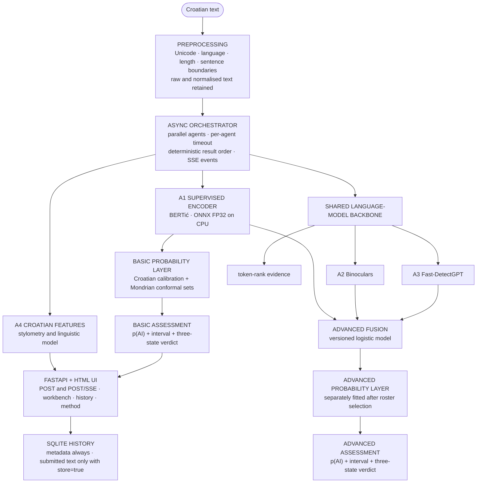
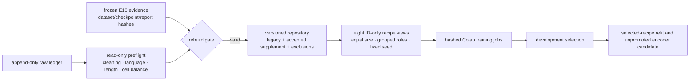
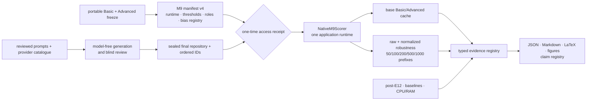

# ARCHITECTURE.md

The system estimates the probability that a Croatian text was machine-generated. It never
returns a verdict: every answer is a calibrated probability, an uncertainty interval and one of
three labels, and it abstains when it has no basis to judge.

Two modes ship. **Basic** is a fine-tuned South Slavic encoder exported to ONNX and served on
the CPU; it is the product. **Advanced** adds two unsupervised statistical detectors over a
shared Gemma-2-2B pair; it is research-only, because it does not improve the operating point,
takes about thirty seconds per request, and did not pass the agreement check between CPU and
GPU scoring.

A per-segment map was removed from the product: its reliability was not good enough to show a
user which part of a document was machine-written. Token-level traces remain as an explanation
alongside the estimate.

Three outcomes change how this architecture should be read:

* **The Basic/Advanced split is now measured, not assumed.** Basic wins on the older
  open-weights cohort (AUROC 0.9946 academic, 0.9999 news) and at strict FPR; Advanced wins on
  frontier API models (0.9314 vs 0.8759 academic; 0.9679 vs 0.9300 news) and is better calibrated
  in every cell. Advanced remains `research_only` on cost: **28.17 s** per analysis on laptop CPU
  against Basic's **0.413 s** (peak RSS 8,489 MB against 4,926 MB), which is the the specification constraint
  as an observation rather than a design claim.
* **The minimum-length gate is derived.** The registered AUROC rule returns 50 words; the product
  ships **100**, and both numbers are reported.
* **Normalisation is a measured defence.** Raw homoglyph@0.1 drops Advanced to AUROC 0.7793;
  normalised, 0.9873. The confusables map earns its place in the pipeline with evidence.

Two registered analyses were never producible by this pipeline and are recorded as such:
`freeze_m9_final_dataset.py` has no argument for mixed-authorship roles or for a bias registry,
so `mixed_authorship` and `bias_fpr` are `skipped_by_scope`. `baselines` was scoped out by
the author. The `manifest-v4 bias registration` named above therefore describes a
capability of the manifest model, not evidence that exists for this run.

The localhost frontend implementation is complete against that contract. A system-Edge browser
suite runs the actual FastAPI/Jinja/Alpine application with model doubles and covers both mode
choices, keyboard submission and result focus, opt-in storage, history and CSV, reduced motion,
320-pixel reflow and the 200%-zoom-equivalent layout. Offline axe-core 4.10.3 reported no serious
or critical WCAG 2 A/AA violations on the empty and completed pages. A separate Edge smoke then
ran both real candidates through the workbench: Basic completed as `basic`, while Advanced
completed as `research_only` with A1/A2/A3 participating and A4 reported separately. This
evidence verifies execution and presentation, not detector accuracy; a manual NVDA pass remains
unclaimed.

Basic and Advanced are **first-class user choices** in the localhost application. The user
selects which analysis runs for the pasted Croatian text: Basic executes A1 BERTić, while
Advanced executes A1 plus the shared Gemma evidence used by A2 Binoculars and A3
Fast-DetectGPT, then applies the A1+A2+A3 fusion; A4 contributes explanations only. E11's
scientific selection of A1 remains part of the evidence and thesis conclusion, but it is not a
feature flag and must never disable or hide the Advanced implementation.

## System diagram

## Dataset control plane

Repository membership and training membership are separate. `data/supplement/` records
lineage, exclusions, frozen roles, recipe quotas, job fingerprints, and the registered
selection rule. Human twins, parents, authors, exact duplicates, verified near duplicates,
generated variants, and perturbations stay in one split group. The final and holdout roles
never enter fitting.

## M9 execution control plane

The native scorer bypasses HTTP transport and rate limiting while calling the same internal
analysis service as the website. It loads the model objects once and reuses A1 for the paired
Basic/Advanced result. Resume is allowed only when the manifest, ordered IDs, candidate hashes,
runtime identity and prior row identities match exactly. Advanced fallback is stored as a failed
Advanced prediction, never as Advanced evidence.

The registered variant plan fixes raw and normalized inputs, ten perturbation conditions and
the five length prefixes before scoring. Its persistent files contain identities and hashes,
not submitted plaintext. External analyses cannot be closed by a generic JSON object: each
artifact must satisfy its analysis-specific schema and repeat the M9 manifest, score, runtime,
configuration, data and regeneration identities.

## Five design points worth defending

1. **Shared backbone.** The observer/performer pair is loaded once and reused by the
   statistical detectors and token evidence. The orchestrator prepares one request-scoped
   `ReducedScores` object and fans it out to A2 and A3, so asynchronous execution cannot
   duplicate or race the two causal-model passes. This keeps Advanced mode feasible on the
   16 GB CPU laptop. The Advanced candidate manifest also binds A2's name and formula to its
   window: V0 uses `binoculars` with `prefix512`, while the registered V4 challenger uses
   `binoculars_v4` with `coverage1024`.
2. **Mode routing.** Basic runs only the fine-tuned encoder. Advanced runs A1 and the shared
   A2/A3 statistical evidence, fuses their raw scores, and attaches A4 explanations. Both
   modes accept Croatian input only, return the same response shape, and remain selectable
   regardless of which one performs better in E11 or M9.
3. **Calibration owns the verdict.** Basic calibrates the encoder score. Advanced consumes
   the encoder's raw score and fits a separate calibration layer around the frozen fusion
   roster. Class-conditional conformal prediction produces each mode's three-state result;
   JavaScript and templates contain no model thresholds.
4. **Graceful degradation.** Every agent returns an `AgentResult`. The orchestrator converts
   timeouts and exceptions into truthful failed-agent results, preserves declared ordering,
   and completes the request with the evidence that remains. With no compatible bundle the
   service stays healthy and abstains.
5. **Data additions are gated.** Generation attempts do not become training data by being
   downloaded. The old-corpus E10 evidence, ingest gates, lineage checks, explicit roles,
   equal-size recipe comparison, and frozen final collections form one auditable chain.

## One request, end to end

`POST /api/v1/analyze` or the SSE endpoint preprocesses the submitted text, applies the
provisional length and Croatian-language gates, and asks the orchestrator to run available
agents concurrently. Each agent has a timeout and emits start/finish/failure events when the
action actually occurs. Fusion, calibration, and Mondrian conformal prediction then produce
a probability, interval, and `LIKELY_HUMAN`, `INCONCLUSIVE`, or `LIKELY_AI`. Segment
experiments remain historical and are not included in the active response contract.

The HTML result fragment and `/pregled` use the same Jinja components. `/metoda` reads agent
and bundle identities at runtime and contains no copied performance figures. `/povijest` and
`/povijest/{run_id}` present the SQLite record without revealing submitted text unless the run
explicitly set `store=true`. Every result names `requested_mode` and `effective_mode`, so a
Basic fallback cannot be mistaken for a successful Advanced execution. JavaScript renders the
typed response and never derives a threshold, verdict or model identity.

The probability rail is a neutral 0–100 scale. It emphasizes the uncertainty interval and marks
the point estimate, while the adjacent text and pattern carry the Mondrian conformal verdict.
There are no fixed low/middle/high probability bands because `INCONCLUSIVE` is a prediction set,
not a numeric interval chosen by the browser.

## Main module map

- `src/oridjidji/data/`: corpus adapters, cleaning, deduplication, splits, sampling, and E12
  supplemental controls.
- `src/oridjidji/detectors/`: supervised and statistical detector implementations.
- `src/oridjidji/detectors/windowing.py`: prefix and two-window coverage without counting
  context tokens twice.
- `src/oridjidji/detectors/llama_cpp_backbone.py`: lazy owned-GGUF Q4 runtime with exact
  token-ID checks and bounded vocabulary reduction.
- `src/oridjidji/training/`: training plans, fitting, export, calibration, fusion, and bundle
  construction.
- `src/oridjidji/evaluation/`: registered metrics, generalisation experiments, robustness,
  significance, and recipe selection.
- `src/oridjidji/evaluation/m9_execution.py` and `api/analysis_runtime.py`: one direct internal
  Basic/Advanced scorer over the same runtime used by the web application.
- `src/oridjidji/evaluation/m9_variant_execution.py` and `m9_variant_adapters.py`: immutable,
  resumable robustness and length inputs plus typed reductions.
- `src/oridjidji/evaluation/m9_manifest.py` and `m9_bias_registry.py`: final-role trust boundary,
  manifest-v4 bias strata and the one-time access receipt.
- `src/oridjidji/evaluation/m9_mixed_cohorts.py`: identity-only mixed-parent plans and blind
  review before accepted records receive their final role.
- `src/oridjidji/data/supplement/final_challenge_stage.py`: model-free stage package, ledger
  verification and blind review for the exact E12 generator revisions.
- `src/oridjidji/evaluation/m9_performance.py`: Basic/Advanced CPU latency and process-RSS
  evidence through the frozen native runtime.
- `src/oridjidji/evaluation/advanced_*.py`: E12 backbone, E9 aggregation/window and fixed-
  threshold E11 rules over consumed development roles.
- `src/oridjidji/segmentation/`: historical overlapping-window scoring and aggregation retained
  for thesis reproduction; the localhost product does not load it.
- `src/oridjidji/segmentation/artifact.py`: historical development-fitted Advanced segment
  uncertainty, never an active response field.
- `src/oridjidji/pipeline/orchestrator.py`: concurrent execution and progress events.
- `src/oridjidji/pipeline/advanced_segments.py`: historical segment scoring that is excluded from
  the served pipeline under an earlier decision/an earlier decision.
- `src/oridjidji/fusion/advanced_promotion.py`: fail-closed Q4, CPU, fusion and segment gates.
- `src/oridjidji/api/`, `web/`, `storage/`: HTTP/SSE interface, Croatian UI, and SQLite history.
